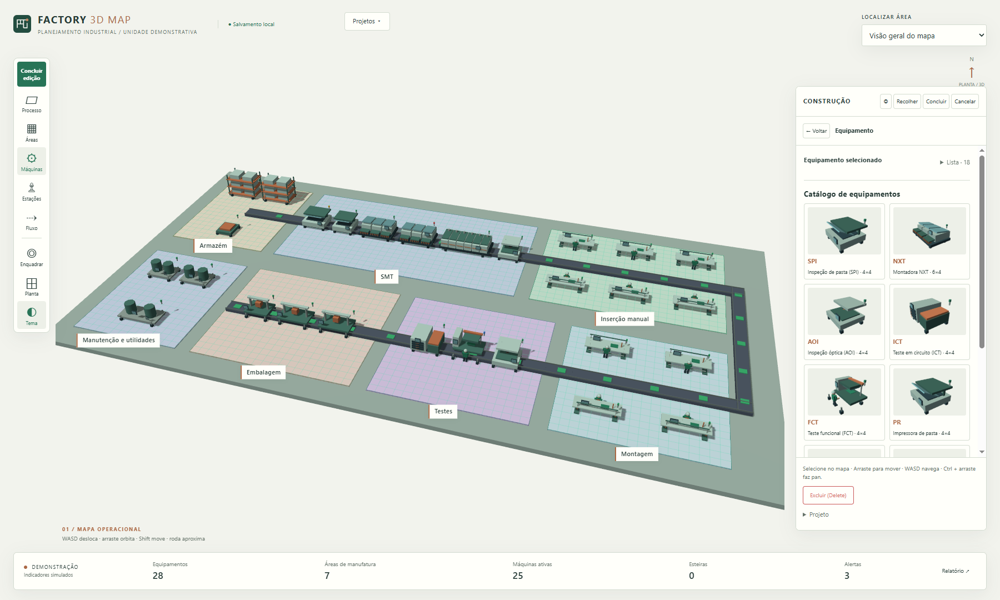

# Factory 3D Map

Mapa e editor industrial tridimensional, com identidade arquitetônica industrial, ardósia, cobre e verde técnico. Projeto independente do Virtual Factory 3D, usado como referência de comportamento.



## Executar

É possível abrir `index.html` diretamente no Chrome. Para uma origem HTTP estável, com Node.js 22 ou superior:

```powershell
npm start
```

Abra [Factory 3D Map local](http://127.0.0.1:8082). Não há instalação de dependências nem build. Three.js r128 e sua licença MIT estão incluídos em `vendor/`; a aplicação não precisa de CDN, fontes remotas ou serviços externos.

## Usar

- **WASD** desloca a câmera; arraste para orbitar; roda aproxima; Shift ou botão direito faz pan.
- **Construir** abre as ferramentas. Processo → áreas → equipamentos/estações → esteiras mantém o fluxo progressivo.
- Arraste um modelo do catálogo para uma área ou clique no catálogo e depois no mapa. Confirme o ID na instalação.
- Selecione e arraste objetos no mapa. Use a alça circular para girar em passos de 90°. Processo e áreas têm quatro alças de redimensionamento. Escape cancela a operação e Delete exclui a seleção.
- Em **Fluxo**, escolha a saída vermelha e a entrada verde. Movimentações atualizam os caminhos.
- O seletor compacto localiza áreas. **Planta** muda para a vista superior e **Enquadrar** restaura a visão geral.
- O inspetor aparece ao selecionar um objeto no monitoramento. O relatório reúne os indicadores demonstrativos.
- **Projetos → Salvar cópia** guarda uma versão nomeada; **Novo projeto** inicia outro layout. Salve uma cópia antes de substituir o layout ativo. As cópias podem ser reabertas após recarregar.

O tema verde é o padrão na primeira abertura. O tema branco usa pisos e equipamentos contrastantes, e a escolha de tema é lembrada ao recarregar.

Layouts ficam no navegador e na origem usada. Arquivo local e HTTP podem ter armazenamentos diferentes. Limpar os dados do navegador também remove os layouts. As chaves são próprias do Factory 3D Map e não carregam dados do Virtual Factory.

## Código

| Arquivo | Responsabilidade |
|---|---|
| `src/engine.js` | Estado, navegação, geometria, edição, conexões, animações e persistência |
| `src/construction.js` | Apresentação e eventos das ferramentas de construção |
| `src/monitor.js` | Painéis demonstrativos de área, equipamento e produção |
| `src/models.js` | Biblioteca procedural exclusiva de modelos e perfil das esteiras |
| `src/shell.js` | Ferramentas verticais, navegação compacta, vistas e tema |
| `src/projects.js` | Biblioteca de cópias nomeadas de projetos |
| `src/map.css` | Sistema visual e layouts responsivos |

SPI com capota inclinada; NXT com módulos e alimentadores; AOI com pórtico e óptica suspensa; forno segmentado com exaustão; ICT com gavetas de instrumentos; FCT com fixture móvel e torre lateral; corte com travessa e cabeçote; bancadas abertas em cavaletes; operadores facetados com capacete; esteiras com trilhos e suportes próprios. Modelos são representações leves, não modelos oficiais de fabricantes.

## Testes

```powershell
npm test
```

O executor usa Chrome instalado, DevTools e SwiftShader em perfil temporário. `CHROME_PATH` permite indicar outro Chrome. As suítes verificam comportamento real no navegador, incluindo drag-and-drop, rotação, colisões, conexões e recarga. Confira [a análise funcional](docs/REFERENCE-AUDIT.md) e [o relatório de validação](docs/VALIDATION.md).

Todos os indicadores de produção, nomes de colaboradores e estados operacionais são dados simulados. Não há conexão com chão de fábrica real.
