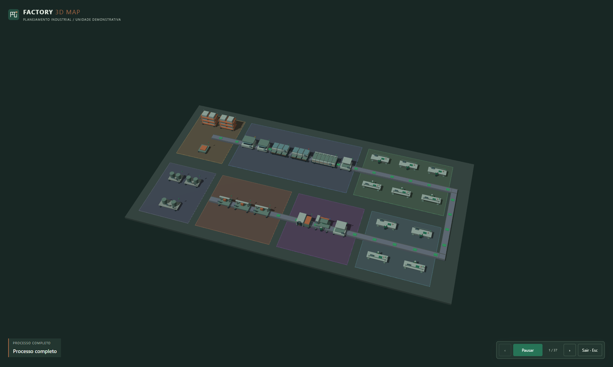
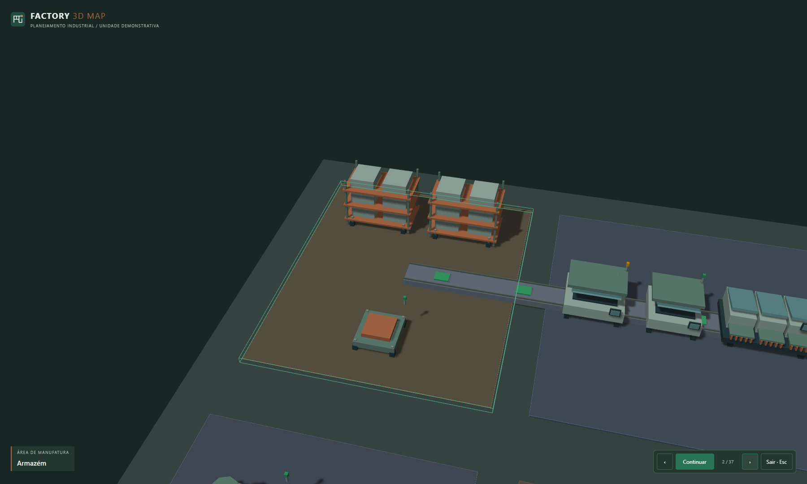
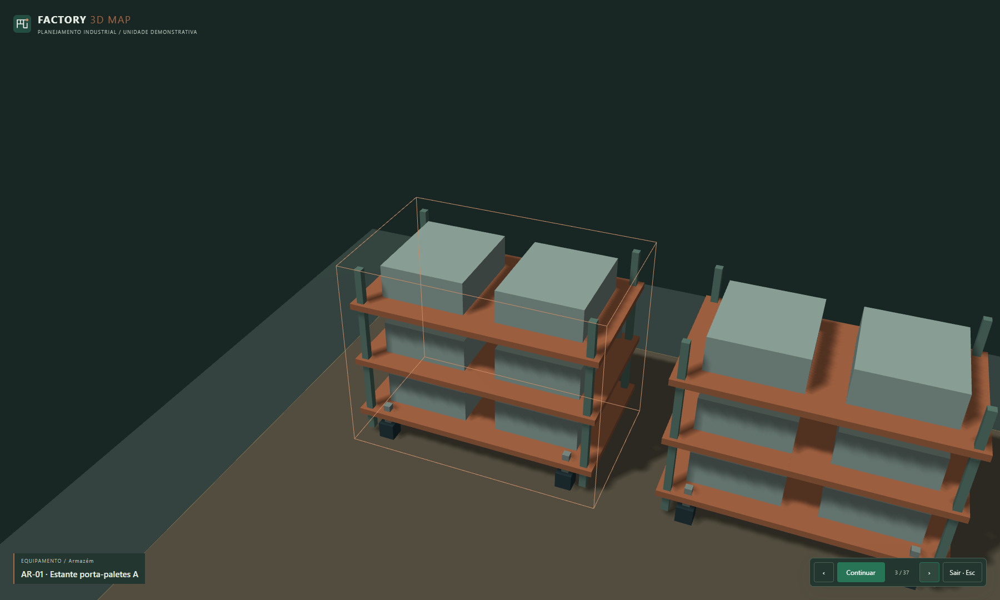

# Modo apresentação — Factory 3D Map

Implementado em 14/11/2026, exclusivamente no produto independente.

## Uso

Clique em **Modo apresentação**, na parte superior. A sequência inicia imediatamente e solicita tela cheia na mesma ação do usuário. Se o navegador não conceder, o filme continua ocupando toda a aplicação, sem modal ou confirmação intermediária.

1. Processo completo, com enquadramento aéreo calculado e contextualização de 4,4 segundos.
2. Primeira área na ordem de cadastro, com transição de 2,4 segundos e permanência de 3,6 segundos.
3. Cada equipamento dessa área, também na ordem de cadastro, com transição de 2 segundos, permanência de 3,2 segundos e leve órbita de 0,12 radiano.
4. Repete áreas → equipamentos até percorrer o layout e termina novamente na visão geral. Ao concluir, permanece pausado nessa vista; **Repetir** inicia outro ciclo.

**Pausar/Continuar**, anterior, próxima cena e **Sair · Esc** permanecem acessíveis. As setas do teclado também mudam de cena. A saída restaura câmera, seleção e contexto do editor. Durante o filme, WASD, edição e exclusão ficam bloqueados. Nenhum layout ou preferência é salvo pelo controlador.

## Referência realmente consultada

O projeto `C:\Projetos\smart-web` foi consultado somente para leitura, no commit `999d432b76585d850d8773fc22988f929401a345`.

| Arquivo | Comportamento identificado |
|---|---|
| `src/data/virtualFactoryTour.js` | Visão geral → área `smt` → equipamento `SPI-01` → exploração livre. Durações de voo: 2400, 2400 e 2000 ms. |
| `src/hooks/useVirtualFactoryTour.js` | Avanço por comandos, confirmação de estado, pausa/retomada e seleção de recursos reais do catálogo. |
| `public/demos/factory-3d-map/tour-adapter.js` | Ajuste ao FOV/aspecto, projeção dos oito cantos, interpolação quintica de posição/distância/ângulos, menor caminho angular e respeito a movimento reduzido. |
| `src/components/projects/VirtualFactoryTour.jsx` | Botões anterior/próximo escolhem a etapa. Não há temporizador de avanço automático nessa versão. |

A reprodução automática, a visita a todas as áreas/equipamentos e os tempos de permanência são implementações novas do Factory 3D Map conforme o pedido. Nenhum balão, texto explicativo, componente React ou interface do site foi copiado. Não há dependência do site, iframe ou protocolo de mensagens em execução.

SHA-256 dos três arquivos principais consultados:

```text
virtualFactoryTour.js  59EF14AABF5C0E93238624F0C9B520ABCD90E4CF29EC0EE9F274CB08010289EE
useVirtualFactoryTour.js  BC8ED3709F2787DCB39A24A697E854CC69DC6C1EF48D2D29F8A5EA49729E133D
tour-adapter.js  EC517FA542E63C3383A8D1D141DA94B560C4F56AE7583B850729F0F129586377
```

## Enquadramento e movimento

- O planejamento usa o piso real do processo, áreas visíveis, limites dos modelos, rotações e conexões internas. Inclui a faixa de movimento dos fixtures.
- Os oito cantos de cada volume determinam a distância mínima com margens para os controles. A órbita inteira é considerada antes da aproximação, evitando cortes ou zoom oscilante.
- As transições usam `6t⁵ − 15t⁴ + 10t³` e rotação pelo caminho angular mais curto, como na referência.
- A câmera permanece acima do maior limite vertical do cenário, com folga. Isso mantém a trajetória fora dos volumes dos equipamentos, inclusive entre áreas.
- A distância de recorte distante cresce conforme necessário; não há câmera com coordenadas fixas nem limite de zoom herdado do editor no modo filme.
- O relógio é integrado pelo loop de renderização. Ocultar a aba pausa o filme; retornar retoma. Pausa não acumula tempo de avanço.
- Em `prefers-reduced-motion: reduce`, as etapas continuam automáticas, com permanência, mas sem órbita ou transição animada.
- Destaques são temporários: contorno do piso da área ou do volume real do equipamento. Materiais e geometrias do layout não são modificados.

## Código

- `src/presentation.js`: planejamento, enquadramento, relógio, controles e restauração.
- `src/presentation.css`: composição própria para desktop, celular, paisagem e tela cheia.
- `src/engine.js`: entrega o controle da câmera ao filme enquanto ativo; mantém o fluxo normal nos demais momentos. O cálculo da câmera também considera a altura do alvo.
- `tests/regressao-presentation.mjs`: testes pelo Chrome/DevTools.

## Validação

Executados e aprovados:

```powershell
node tests/regressao.mjs index.html --presentation
node tests/regressao.mjs index.html --wasd
node tests/regressao.mjs index.html --criador
```

Cobertura específica:

- Início pelo botão, ocultação dos controles operacionais e foco no processo.
- Amostragem com relógio sintético de todas as 37 cenas da demonstração: ordem, enquadramento sem cortes e altitude segura em todo o percurso.
- Pausa, avanço, retorno ao início, conclusão, repetição e saída por Esc.
- Câmera, seleção e campos ainda não salvos do editor restaurados; armazenamento e equipamentos preservados, inclusive sob tentativa de Delete/WASD durante o filme.
- Processo deslocado para `(210, -155)`, áreas sem equipamentos, modelos rotacionados e bancada com operador.
- Processo de 800 × 400 em 390 × 844 e 844 × 390, com ajuste do plano distante.
- Movimento reduzido, miniatura de UI móvel e capturas inspecionadas visualmente.
- Pedido nativo de tela cheia: o Chrome headless executou o fallback dentro da aplicação. O contrato de entrada aceita, saída e aceitação tardia foi validado com a API simulada; não se afirma que a entrada nativa tenha sido aceita nesse ambiente.
- Nenhuma exceção de página ou erro de console nas suítes aprovadas.

Resultados completos em [presentation-validation.txt](presentation-validation.txt). As imagens abaixo são capturas do novo produto.






