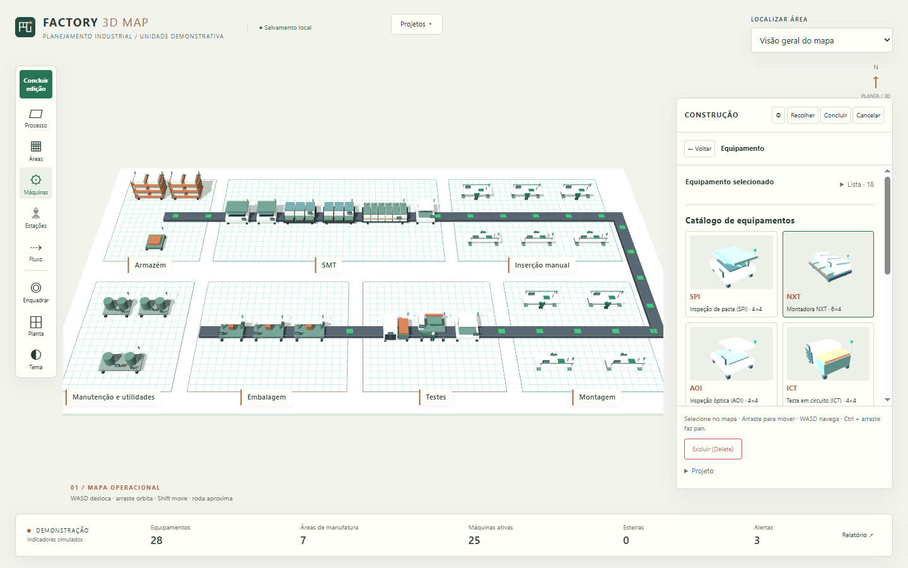
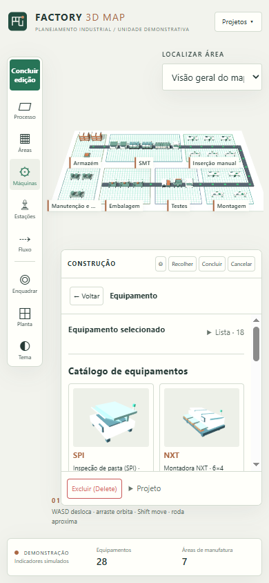

# Implementação e validação — Factory 3D Map

Entrega independente preparada em 12/11/2026. Referência e inventário de comportamento em [REFERENCE-AUDIT.md](REFERENCE-AUDIT.md).

## Implementação

- Composição nova: mapa como ambiente principal, ferramentas verticais, seletor compacto de áreas, faixa discreta de produção e inspetor contextual. O editor de construção ocupa um painel lateral; não há editor inferior no desktop.
- Tema mineral claro por padrão, ardósia, cobre e verde técnico; marca própria inspirada em uma planta. Tema escuro opcional. Fontes do sistema, sem carregamento remoto.
- Geradores procedurais novos de SPI, NXT, AOI, forno, ICT, FCT, corte, inspeção, bancadas, operadores e esteiras. Perfis, estruturas e silhuetas foram construídos especificamente para este produto.
- Lógica funcional preservada em cópia independente: navegação, colisões, restrições de bancadas, redimensionamento, conexão/roteamento e persistência. Apresentações separadas em `construction.js`, `monitor.js`, `models.js`, `map.css` e `shell.js`.
- Layout ativo em `factory3dmap.layout.v1`; cópias nomeadas em `factory3dmap.projects.v1`. Sem leitura, migração ou escrita da chave do Virtual Factory.
- Acréscimos: biblioteca de cópias nomeadas, equipamento de corte `CUT`, planta superior e distribuição local do Three.js com licença MIT.
- Retorno e cancelamento acessíveis no fluxo de construção. A manipulação mantém as validações e incrementos de rotação da referência.

## Resultado dos testes

Nove suítes do novo produto aprovadas, mais inicialização por arquivo direto. O [registro consolidado](validation-output.txt) contém as execuções aprovadas. As oito suítes da referência também foram executadas sobre uma cópia de teste do HTML original; testes que falharam em execução concorrente foram repetidos isoladamente. A referência não foi corrigida ou editada.

| Suíte | Cobertura | Resultado final |
|---|---|---|
| Geral | Demonstração, navegação orbital/pan/zoom, processos, quatro cantos, áreas, catálogo, instalação, edição, colisões, exclusão, trajetos em U, dados inválidos e armazenamento indisponível | Aprovada |
| Bancadas | Contato de costas no grid, limites físicos reais, disposição lateral/paralela, 180°, colisão, corredor de esteira e espaçamento automático | Aprovada |
| Postos manuais | Operadores, três jigs, lado, direção do fluxo, quatro rotações conectadas, preview/instalação e ciclo animado do testador | Aprovada |
| Alinhamento | Projeção sobre grid, snap, guias, equipamento girado, drag-and-drop nativo e preview de conexões | Aprovada |
| Seleção | Contorno sobre o novo modelo, propriedades, tema, movimentação, troca de seleção e liberação de geometria | Aprovada |
| WASD | Oito direções, azimute, zoom, aceleração/desaceleração, integração a 30/60/120 FPS, foco e proteção de campos | Aprovada |
| Criador | Rotação interativa, última orientação válida, Escape, conexões atualizadas e responsividade | Aprovada |
| Menu progressivo | Bloqueio de etapas, voltar, processo → área → equipamentos → esteiras e restauração após recarga | Aprovada |
| Produto independente | Chave original intocada, cópia nomeada, novo projeto, reabertura, sete silhuetas distintas dentro das pegadas, ferramentas e planta | Aprovada |
| Arquivo direto | Inicialização do HTML com Three.js local | Aprovada |

As adaptações visuais dos testes verificam o inspetor lateral, catálogo em grade e tema claro inicial. As verificações de geometria, espaçamento, corredores, conexões e persistência continuam ativas. O executor aguarda o evento de carregamento ao recarregar a página para evitar avaliar o documento anterior.

## Desempenho e apresentação

- Cenário exercitado: seis áreas, 24 equipamentos e 18 esteiras. A contagem de geometrias permaneceu em **643 antes e depois** das atualizações, sem crescimento nesse cenário.
- Também foram renderizados os 28 equipamentos da demonstração, miniaturas do catálogo, preview de instalação e animações de placas/fixture.
- Interface exercitada em 1800×1080, 1440×900, 1366×768, 1280×720, 1024×768, 800×600 e 390×844. Capturas de desktop e celular foram inspecionadas visualmente.
- Ambiente: Node.js 24.21.0, Chrome 157, Three.js r128, ANGLE/SwiftShader. Isso verifica funcionamento com renderização por software, sem constituir um benchmark de FPS em GPU física.
- O bloqueio de ambos os CDNs usados pela referência não impede o novo produto de funcionar, pois a biblioteca é local.

## Limitações

Nenhuma capacidade operacional efetivamente implementada na referência foi deixada sem reprodução. O seletor “Tipo” de área da referência não possuía efeito ou persistência e foi retirado da nova apresentação; os detalhes estão na auditoria.

Os indicadores são demonstrativos. A aplicação não possui integração com equipamentos reais, servidor de dados ou sincronização entre computadores. Projetos são locais ao navegador e à origem. Não foram validados outros navegadores, gestos de toque, GPU física ou uso contínuo por várias horas.

